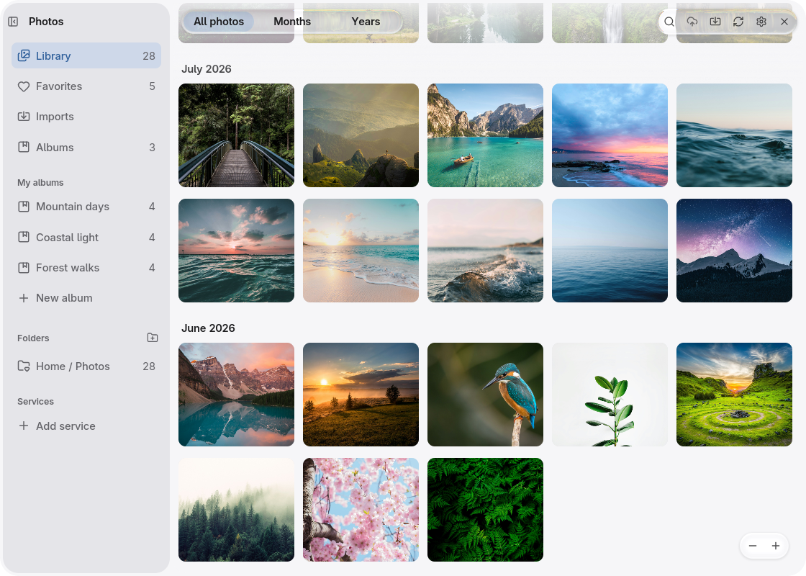
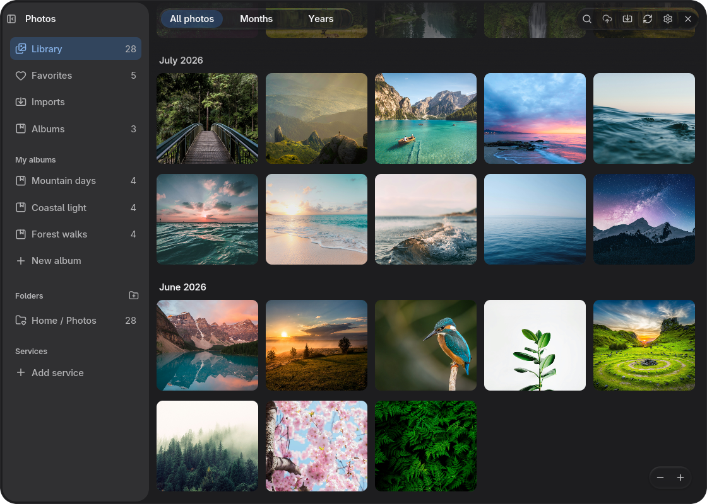
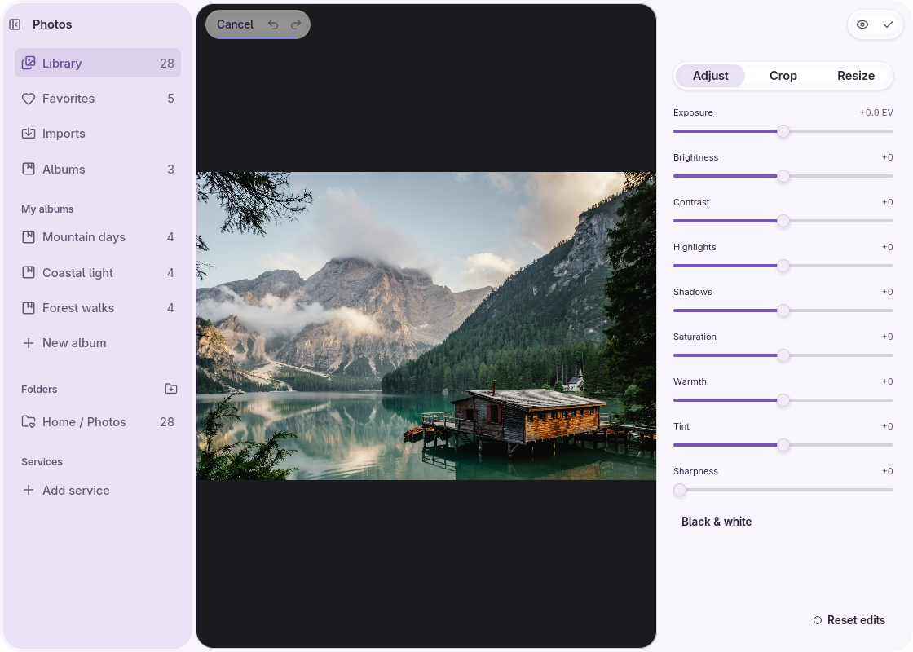
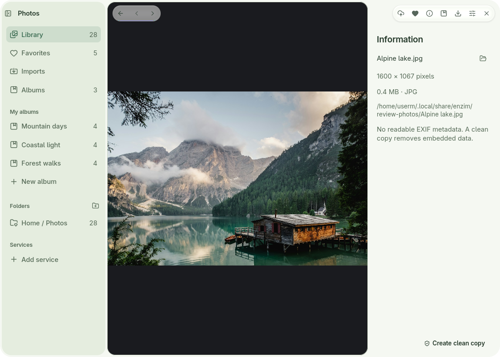
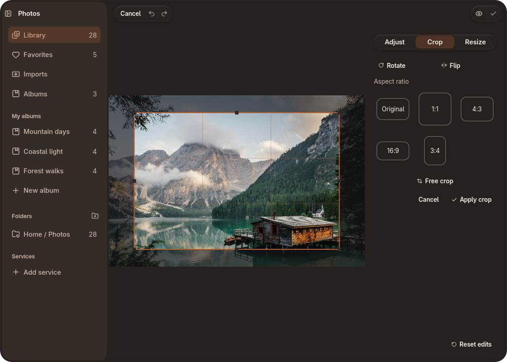
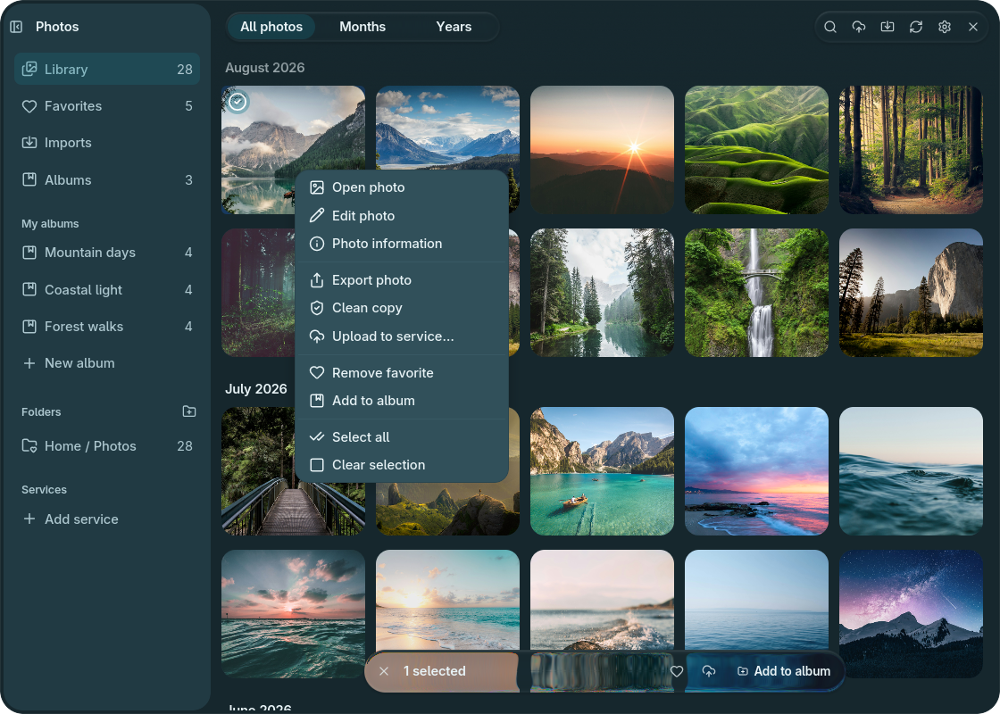
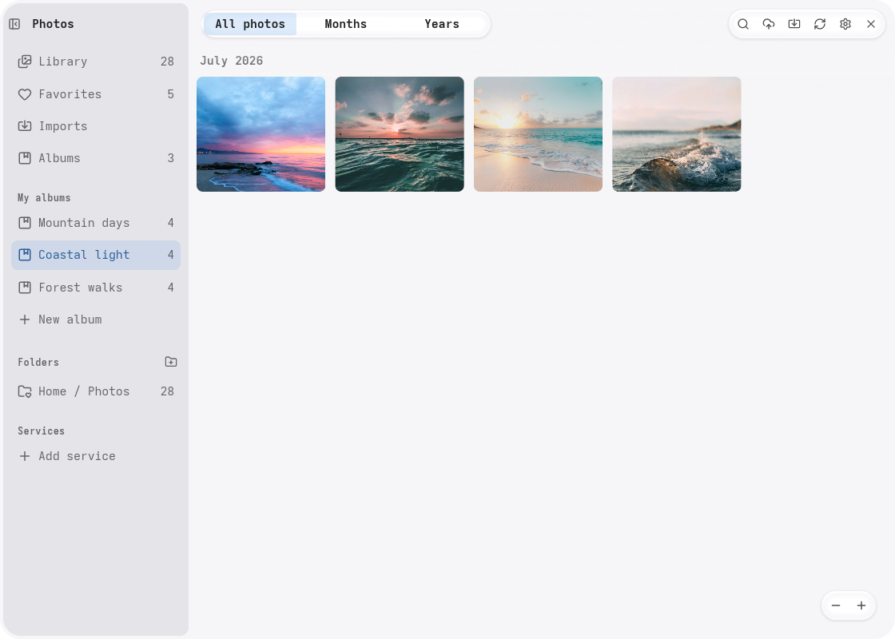
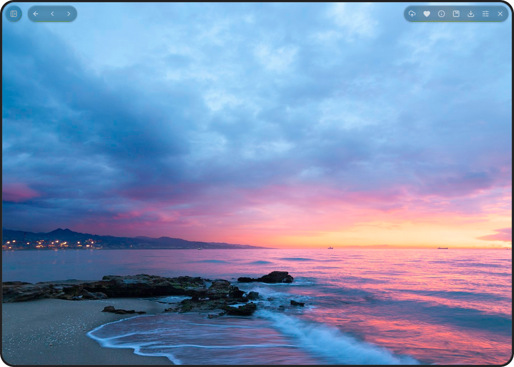

# Photos

A local-first photo library and reversible editor built with
[enzUI](https://github.com/enz1m/enzui). Browse your collection, organize albums,
and edit or export copies while keeping originals unchanged.

<table>
  <tr>
    <td align="center">
      <a href="docs/screenshots/basic-light.png"></a>
      <br><sub>Default · Light</sub>
    </td>
    <td align="center">
      <a href="docs/screenshots/basic-dark.png"></a>
      <br><sub>Default · Dark</sub>
    </td>
    <td align="center">
      <a href="docs/screenshots/lavender.png"></a>
      <br><sub>Lavender · Adjustments</sub>
    </td>
    <td align="center">
      <a href="docs/screenshots/sage.png"></a>
      <br><sub>Sage · Photo information</sub>
    </td>
  </tr>
  <tr>
    <td align="center">
      <a href="docs/screenshots/ember.png"></a>
      <br><sub>Ember · Crop</sub>
    </td>
    <td align="center">
      <a href="docs/screenshots/lagoon.png"></a>
      <br><sub>Lagoon · Context menu</sub>
    </td>
    <td align="center">
      <a href="docs/screenshots/precision.png"></a>
      <br><sub>Precision · Album</sub>
    </td>
    <td align="center">
      <a href="docs/screenshots/comfort.png"></a>
      <br><sub>Comfort · Image viewer</sub>
    </td>
  </tr>
</table>

Click a screenshot to enlarge. Example photography from [Unsplash](https://unsplash.com/license).

## Features

- Scrollable photo and video library, date views, search, favorites and albums.
- Reversible crop, rotation, resize and color adjustments, with undo and redo.
- Native drag and drop between the library, albums and other applications.
- JPEG, PNG, WebP, TIFF, HEIC and more; optional host decoders add camera RAW,
  AVIF, JPEG XL and Photoshop composites.
- Video and motion-photo playback, trimming and source-resolution frame saving.
- Optional Immich connections, albums, search and additive upload/download rules.
- Desktop/theme fonts, light and dark themes, and English, German and Arabic.

## Build and run

Linux, Rust **1.99.1**, a C compiler, pkg-config, and the native Wayland,
GStreamer, curl/OpenSSL and fontconfig development libraries are required.
Minimum supported Rust is **1.95**. The repository selects the development
toolchain automatically. Use a Vulkan driver or Mesa software renderer.

On Arch Linux, the native prerequisites include `base-devel pkgconf wayland
libxkbcommon fontconfig gstreamer gst-plugins-base-libs curl openssl libheif`.
Install GStreamer codecs for the media formats you use. See
[media support](docs/FORMAT_SUPPORT.md) for optional image decoders and limits.

```sh
git clone https://github.com/enz1m/photos.git
cd photos
cargo fetch --locked
cargo build --locked
cargo run --locked
```

The framework uses the public [enzUI Alpha 0.1](https://github.com/enz1m/enzui/releases/tag/v0.1.0-alpha.1)
tag and pinned enzim foundation forks. No framework submodule or sibling checkout
is needed. Wayland is enabled by default; add `--features x11` for an X11 build.

## Library and data

Photos reads `~/Photos` by default. Added folders are read in place; imports,
exports and cleaned copies create new files without overwriting existing ones.
Albums, favorites and edit recipes are stored separately from originals in
`$XDG_STATE_HOME/enz-photos/catalog.json` (normally
`~/.local/state/enz-photos/catalog.json`). Invalid or newer catalogs are preserved
rather than replaced. Gallery previews use bounded memory and a configurable
disk cache; source images are never the cache.

The app follows the shared enzUI theme and per-app override for
`org.enzimos.Photos`. Press F1 for keyboard shortcuts. Pass a local image path to
open its viewer directly, or `--add-folder FOLDER` to register a library source.
The desktop portal supplies native file/folder dialogs, with an in-app fallback.

Linux “Open With” uses the [desktop entry](assets/org.enzimos.Photos.desktop)
and [supplemental MIME definitions](assets/org.enzimos.Photos-mime.xml). Desktop
integration installs these in the standard applications and MIME directories
and refreshes their caches. They advertise supported image and video formats;
optional decoders still depend on the host. Installing an association does not
make Photos the default viewer. Opening a local file starts the image viewer
with its sidebar hidden, including requests sent to an already running instance.


[Photo services](docs/PHOTO_SERVICES.md) explains Immich connections, keyring
storage and transfer behavior. Remote transfers are opt-in and additive;
deletions and edit recipes are not mirrored.

## Development

```sh
cargo fmt --all -- --check
cargo test --locked --workspace
cargo clippy --locked --workspace --all-targets --all-features -- -D warnings
```

Tests use disposable libraries. The optional live-service check is
ignored until configured; the normal suite does not contact a real photo account.
Keep personal libraries and local review data outside version control.

Licensed under [MIT](LICENSE).
